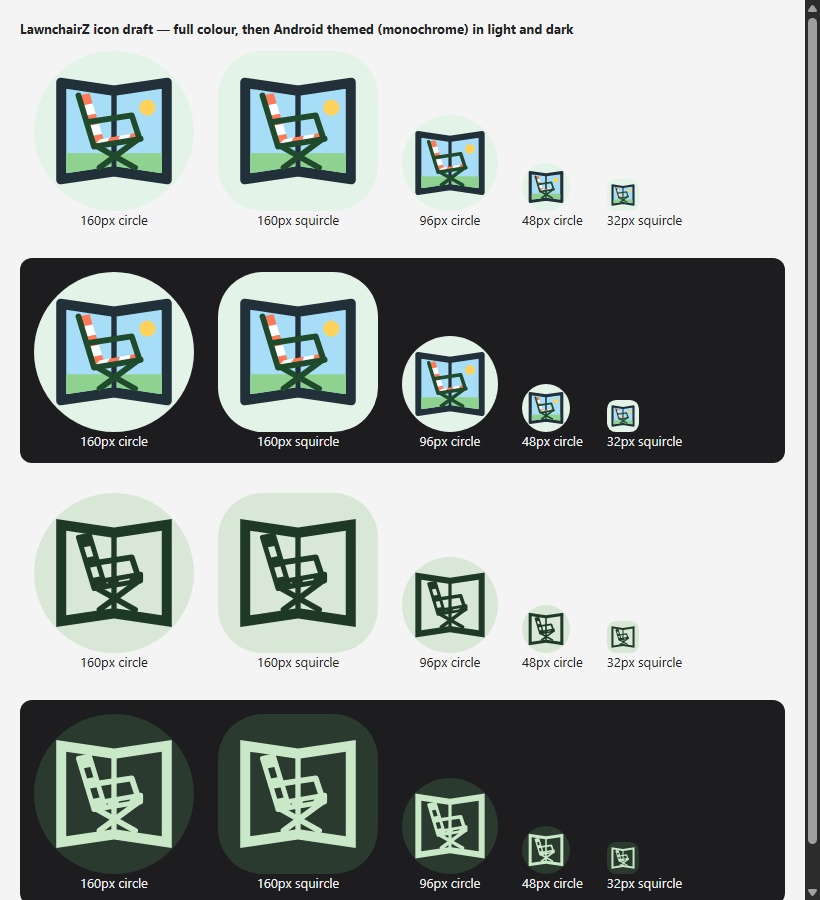

# LawnchairZ app icon

The LawnchairZ icon shows a striped folding lawn chair on the inner screen of an open
foldable phone: two dark halves angled toward the viewer, a hinge gap, sky, grass and sun,
on a pale green background (`#E4F3E7`).

It is original artwork for LawnchairZ. It replaces Expressive Launcher's Bloom icon, which
identifies Expressive, and it does not use Lawnchair's logo.

## Files

- `docs/assets/lawnchairz/lawnchairz-icon.svg`: source artwork, background and foreground.
- `docs/assets/lawnchairz/lawnchairz-icon-monochrome.svg`: single-colour source for themed icons.
- `docs/assets/lawnchairz/lawnchairz-icon-preview.png`: the icon at 32–160 px in circle and
  squircle masks, in colour and themed, on light and dark backgrounds.
- `android/lawnchairz/res/drawable/ic_launcher_lawnchairz_foreground.xml`: vector foreground layer.
- `android/lawnchairz/res/drawable/ic_launcher_lawnchairz_monochrome.xml`: vector themed-icon layer.
- `android/lawnchairz/res/values/colors.xml`: `lawnchairz_launcher_icon_background`.

The adaptive icons in `android/lawnchairz/res/drawable/ic_launcher_home.xml` and
`mipmap-anydpi-v26/` combine these layers for the app, Preferences, round and themed
icons. Upstream Lawnchair flavors keep their own icons.

## Editing the icon

The Android layers are hand-written `VectorDrawable`s on a 108dp canvas, with the artwork
inside the 66dp safe zone. They match the SVG sources path for path: the screen clip is
a `<clip-path>` group, and the themed layer's frame is an even-odd path, because
`VectorDrawable` has no masks. When you change the artwork, update the SVG and the
matching vector together. See
[Android adaptive icon requirements](https://developer.android.com/develop/ui/compose/system/icon_design_adaptive).
